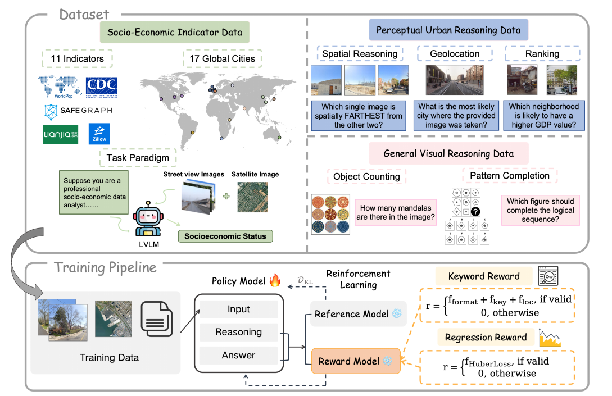

# CityRiSE

This repo is for CityRiSE: Reasoning Urban Socio-Economic Status in Large Vision-Language Models via Reinforcement Learning

## 📢 News

* 🎉: (2026.07) CityRiSE has been accepted to **ACM MM 2026**.

## Introduction

Urban socio-economic sensing plays a vital role in advancing global sustainable development goals. With the rise of Large Vision-Language Models (LVLMs), new opportunities have emerged to address this challenge by framing it as a multi-modal perception and reasoning task. However, recent studies show that LVLMs still struggle to make accurate and interpretable socio-economic predictions from visual data. To overcome these limitations and fully exploit the potential of LVLMs, we propose **CityRiSE**, a novel framework for **R**eason**i**ng urban **S**ocio-**E**conomic status in LVLMs via reinforcement learning (RL). With a carefully curated multi-modal dataset and a verifiable reward design, our approach guides the LVLM to focus on semantically meaningful visual cues, enabling structured and goal-oriented reasoning for generalist socio-economic status prediction. Experiments demonstrate that CityRiSE with emergent reasoning process significantly outperforms existing baselines, improving both prediction accuracy and generalization across diverse urban contexts, particularly for predictions on unseen cities and unseen indicators. This work highlights the promise of combining RL and LVLMs for interpretable and generalist urban socio-economic sensing.

## 🌐 Framework

CityRiSE integrates three types of data with a GRPO-based RL training pipeline:

- Socio-Economic Indicator Data
- Perceptual Urban Reasoning Data
- General Visual Reasoning Data

Two verifiable rewards — Keyword Reward and Regression Reward — guide the model toward both semantic grounding and numeric precision.


## 🗂️ Code Structure

```
- data/                # training and evaluation data 
- data_process/        # scripts for preparing data for training
- evaluate/            # scripts for evaluation 
```

## ⚙️ Installation

Install dependencies:

```bash
conda create -n cityrise python==3.10
pip install -r requirements.txt
```

## 🧩 Data

All training and evaluation data are stored under the `data/` folder, organized as:

- `data/train/` — processed training data
- `data/eval/` — evaluation data covering both seen and unseen cities/indicators

We build upon the [CityLens](https://arxiv.org/abs/2506.00530) dataset as the data foundation.

## 🚀 Training

We use the [EasyR1](https://github.com/hiyouga/EasyR1) reinforcement learning framework for model optimization.
CityRiSE employs GRPO with Keyword Reward and Regression Reward to induce structured reasoning behavior in LVLMs.

To start training:

```bash
bash qwen2_5_vl_7b_multi_image_city.sh
```

This script launches RL training using Qwen2.5-VL-7B as the base LVLM on the processed data.

## 🧮 Evaluation

To evaluate trained models, run:

```bash
bash evaluate/eval.sh
```

This script computes the coefficient of determination (R²) for all indicators and generates the final benchmarking results.

## 🌟 Citation

If you find this work helpful, please cite our paper.

```shell
@article{liu2025cityrise,
  title={Cityrise: Reasoning urban socio-economic status in vision-language models via reinforcement learning},
  author={Liu, Tianhui and Pang, Hetian and Zhang, Xin and Feng, Jie and Hui, Pan and Li, Yong},
  journal={arXiv preprint arXiv:2510.22282},
  year={2025}
}
```


## 👏 Acknowledgement

We greatly appreciate the following GitHub repositories for their valuable code and efforts:

- https://github.com/hiyouga/EasyR1 for Training Codes
- https://github.com/tsinghua-fib-lab/CityLens for Valuable Datasets

## 📩 Contact

If you have any questions or want to use the code, feel free to contact: Tianhui Liu ([tianhuiliu06@gmail.com](mailto:tianhuiliu06@gmail.com))
